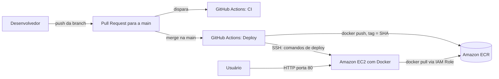

# API Python para demonstrar DevOps

Repositório didático para apresentar, em uma única aplicação, três ideias que se conectam:

1. uma API HTTP escrita em Python;
2. integração contínua com GitHub Actions;
3. execução reproduzível com Docker.

O projeto utiliza FastAPI, pytest, Ruff, GitHub Actions e Docker. Os dados ficam em memória para manter a atenção da aula no fluxo DevOps, sem introduzir banco de dados.

## O que os estudantes devem observar

- O código funciona localmente e no runner do GitHub.
- A mesma suíte de testes é executada pelo desenvolvedor e pelo pipeline.
- O Dockerfile descreve o ambiente necessário para executar a API.
- O pipeline só testa o container depois que qualidade e testes foram aprovados.
- Logs, cobertura e relatórios funcionam como evidências, não apenas como mensagens coloridas.

## Estrutura do repositório

```text
.
├── .github/workflows/ci.yml   # pipeline de integração contínua
├── app/
│   ├── __init__.py
│   └── main.py                # API FastAPI
├── docs/
│   ├── API.md
│   ├── DOCKER.md
│   ├── GITHUB-ACTIONS.md
│   └── ROTEIRO-AULA.md
├── tests/test_api.py          # testes automatizados
├── .dockerignore
├── .python-version
├── compose.yaml
├── Dockerfile
├── pyproject.toml             # configuração de pytest, cobertura e Ruff
├── requirements.txt           # dependências de execução
└── requirements-dev.txt       # dependências de desenvolvimento e CI
```

## 1. Executar localmente

Pré-requisitos: Git e Python 3.13.

### Linux e macOS

```bash
python3 -m venv .venv
source .venv/bin/activate
python -m pip install --requirement requirements-dev.txt
uvicorn app.main:app --reload
```

### Windows PowerShell

```powershell
py -3.13 -m venv .venv
.venv\Scripts\Activate.ps1
python -m pip install --requirement requirements-dev.txt
uvicorn app.main:app --reload
```

Acesse:

- API: <http://localhost:8000>
- documentação Swagger: <http://localhost:8000/docs>
- verificação de saúde: <http://localhost:8000/health>

## 2. Experimentar a API

```bash
curl http://localhost:8000/health

curl -X POST http://localhost:8000/tasks \
  -H "Content-Type: application/json" \
  -d '{"title":"Estudar integração contínua"}'

curl http://localhost:8000/tasks

curl -X PATCH http://localhost:8000/tasks/1/done
```

Endpoints:

| Método | Caminho | Objetivo | Resposta esperada |
|---|---|---|---|
| GET | `/` | Apresentar a API | `200` |
| GET | `/health` | Informar saúde e versão | `200` |
| GET | `/tasks` | Listar tarefas | `200` |
| POST | `/tasks` | Criar uma tarefa | `201` |
| PATCH | `/tasks/{id}/done` | Concluir uma tarefa | `200` ou `404` |

Veja a explicação do código em [docs/API.md](docs/API.md).

## 3. Executar as verificações locais

```bash
ruff check .
ruff format --check .
pytest --cov=app --cov-report=term-missing
```

Esses comandos são deliberadamente iguais aos usados no GitHub Actions. Se uma verificação falhar localmente, ela também deverá falhar no pipeline.

Para aplicar a formatação automaticamente:

```bash
ruff format .
```

## 4. Publicar no GitHub e acionar a CI

O diretório já é inicializado como repositório Git local. Crie um repositório vazio no GitHub e execute:

```bash
git remote add origin https://github.com/SEU-USUARIO/devops-python-api.git
git push -u origin main
```

O arquivo `.github/workflows/ci.yml` dispara o pipeline em três situações:

- `push` na branch `main`;
- `pull_request` destinado à `main`;
- execução manual pela aba **Actions**.

Na aba **Actions**, abra a execução e faça a leitura nesta ordem:

1. workflow;
2. job;
3. primeiro step que falhou;
4. comando e mensagem que explicam a falha.

A explicação detalhada do YAML está em [docs/GITHUB-ACTIONS.md](docs/GITHUB-ACTIONS.md).

## 5. Executar com Docker

```bash
docker build -t devops-python-api:v1 .
docker run --rm -p 8000:8000 --name devops-python-api devops-python-api:v1
```

Em outro terminal:

```bash
curl http://localhost:8000/health
docker ps
docker logs devops-python-api
```

Com Docker Compose:

```bash
docker compose up --build
docker compose down
```

Veja a leitura detalhada do Dockerfile em [docs/DOCKER.md](docs/DOCKER.md).

## Falhas intencionais para demonstrar

### Falha de teste

Em `app/main.py`, altere temporariamente a versão do health check para `2.0.0`. O teste espera `1.0.0`, então o pytest e o pipeline devem falhar.

### Falha de qualidade

Adicione um import não utilizado no início de `app/main.py`:

```python
import os
```

O step `ruff check .` localizará o problema.

### Falha de rede no container

No `Dockerfile`, troque `--host 0.0.0.0` por `--host 127.0.0.1`. O processo iniciará, mas o serviço não ficará acessível pela porta publicada no host.

## Próximos desafios

- Adicionar um endpoint `DELETE /tasks/{id}` e seus testes.
- Executar os testes em uma matriz com Python 3.12, 3.13 e 3.14.
- Publicar a imagem em um registry somente após a aprovação dos testes.
- Substituir o armazenamento em memória por um banco de dados.

## Tecnologias utilizadas

- **FastAPI**: framework da API HTTP.
- **pytest**: testes automatizados (com `pytest-cov` para cobertura).
- **Ruff**: análise estática e verificação de formatação.
- **Docker**: empacotamento da API em uma imagem reproduzível.
- **GitHub Actions**: automação dos pipelines de CI e CD.
- **Amazon ECR**: registry privado onde ficam as imagens Docker.
- **Amazon EC2**: servidor que executa o container da API publicada.

## Pipeline de integração contínua

O arquivo `.github/workflows/ci.yml` (workflow "CI Python") executa dois jobs:

1. **Qualidade e testes**: instala as dependências, roda `ruff check .`, `ruff format --check .` e `pytest` com cobertura, e guarda os relatórios como artefatos.
2. **Build e teste do container**: depende do primeiro job (`needs`), constrói a imagem Docker, sobe o container e consulta `/health`.

O workflow dispara em **pull requests destinados à `main`** e também manualmente (`workflow_dispatch`). Ele não roda em `push` na `main`, porque o `deploy.yml` já executa os testes nesse evento e o `push` duplicaria a execução.

O merge deve exigir o status check verde (configurado na proteção da branch `main`) para que código com falha de qualidade, teste quebrado ou imagem que não sobe nunca chegue à `main`, que é a branch que dispara o deploy.

## Pipeline de entrega contínua

O arquivo `.github/workflows/deploy.yml` (workflow "Deploy") dispara a cada `push` na `main`, ou seja, após o merge de um pull request. Uma `concurrency` garante que só um deploy rode por vez, sem cancelar o que já está em andamento.

- **Job `test` (Testes)**: instala as dependências de desenvolvimento e executa `pytest`.
- **Job `deploy` (Build, push no ECR e deploy na EC2)**: só começa se o job `test` for aprovado, pois declara `needs: test`. Ele:
  1. configura as credenciais AWS a partir dos GitHub Secrets;
  2. autentica no Amazon ECR;
  3. constrói a imagem e a publica no ECR com a **tag igual ao SHA do commit** (`github.sha`), o que identifica exatamente qual código está em cada imagem e permite rastrear e reverter versões;
  4. conecta na EC2 por SSH, baixa a imagem, substitui o container anterior, publica a porta 80 da EC2 na porta 8000 do container e confere o `/health` antes de terminar.

## Arquitetura de implantação



- As credenciais usadas pela pipeline para publicar no ECR e acessar a EC2 (chave de acesso AWS, host, usuário e chave SSH) ficam em **GitHub Secrets**: `AWS_ACCESS_KEY_ID`, `AWS_SECRET_ACCESS_KEY`, `AWS_REGION`, `EC2_HOST`, `EC2_USER` e `EC2_SSH_KEY`. Nenhum valor sensível é versionado no repositório.
- A **EC2 autentica no ECR por IAM Role** associada à instância, portanto não guarda chaves de acesso para baixar as imagens.

## Como verificar a versão implantada

1. Consulte o endpoint de saúde da API publicada e confira o campo `version`:

   ```bash
   curl http://<URL-DA-API>/health
   ```

   Resposta esperada: `{"status":"ok","version":"1.0.0"}`.

2. Compare o commit implantado com a imagem no ECR: na EC2, `docker ps` mostra a imagem em execução, cuja tag é o SHA do commit. Esse SHA deve ser igual à tag da imagem mais recente no repositório do ECR e ao commit exibido na execução do workflow "Deploy" na aba **Actions**.

## URL da API publicada

PREENCHER depois do deploy

## Evidências da execução das pipelines

PREENCHER depois do deploy

## Nota de segurança

A porta 22 (SSH) da EC2 está aberta para os runners do GitHub, cujos IPs variam. Isso é um trade-off aceito para este trabalho. A melhoria seria usar **OIDC** entre GitHub e AWS, eliminando as chaves de longa duração dos Secrets.

## Referências oficiais

- [GitHub Actions: criar e testar Python](https://docs.github.com/pt/actions/tutorials/build-and-test-code/building-and-testing-python)
- [actions/checkout](https://github.com/actions/checkout)
- [actions/setup-python](https://github.com/actions/setup-python)
- [actions/upload-artifact](https://github.com/actions/upload-artifact)
- [FastAPI](https://fastapi.tiangolo.com/)
- [Docker para Python](https://docs.docker.com/language/python/)
